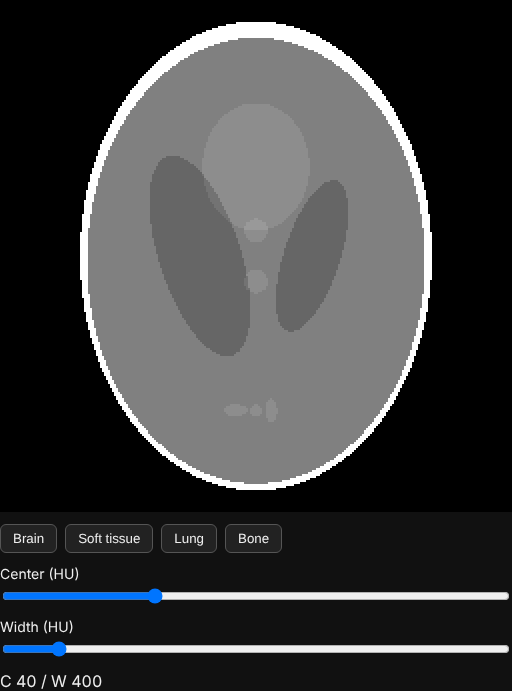
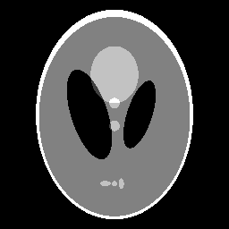
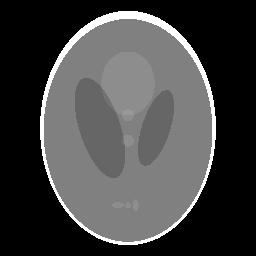
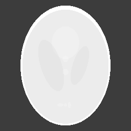
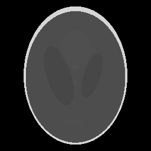

# Medical Image Windowing

[](https://github.com/RachidAifar/medical-image-windowing/actions/workflows/ci.yml)

A small **C# / .NET 8** library and **TypeScript** UI widget for **window/level** adjustment of CT images: the contrast control every radiology viewer has. Both implementations follow the DICOM standard, are covered by unit, regression and browser acceptance tests, and are verified to produce **byte-identical output**.



## Why window/level?

CT scanners measure tissue density in Hounsfield units (HU), from about −1000 (air) to +3000 (dense bone). A screen shows only 256 gray levels. A **window** chooses which HU range is spread over those gray levels:

| Brain (C 40 / W 80) | Soft tissue (C 40 / W 400) | Lung (C −600 / W 1500) | Bone (C 400 / W 1800) |
|---|---|---|---|
|  |  |  |  |

The same slice looks completely different in each window. The brain window separates tissue (40 HU) from fluid (0 HU); the bone window makes them look the same but shows the skull clearly.

The images come from a **synthetic head phantom** (Shepp-Logan geometry with realistic HU values), so the repository contains no patient data.

## What's inside

```
src/ImageWindowing/        C# library
  WindowLevel.cs             window definition and validation (DICOM PS3.3 C.11.2.1.2)
  WindowingTransform.cs      linear VOI function + 64K lookup table for fast rendering
  Presets.cs                 brain, soft tissue, lung, bone
  HeadPhantom.cs             synthetic CT slice in HU
  PngWriter.cs               grayscale PNG encoder (no third-party libraries)
src/ImageWindowing.Cli/    command-line tool (imgwin)
tests/ImageWindowing.Tests xUnit tests
web/                       TypeScript widget (Vite), Vitest + Playwright tests
testdata/lut-golden.json   regression data shared by both test suites
docs/TESTING.md            test strategy and manual test checklist
```

## Quick start

Requires the .NET 8 SDK and Node.js 22.

```bash
# Render the phantom with a preset or a custom window
dotnet run --project src/ImageWindowing.Cli -- render --preset lung --out lung.png
dotnet run --project src/ImageWindowing.Cli -- render --center 50 --width 350 --out custom.png

# Run the interactive widget
cd web
npm ci
npm run dev        # open http://localhost:5173
```

In the widget, drag **left/right** on the image to change the width (contrast) and **up/down** to change the center (brightness), as in clinical viewers. Sliders work with the keyboard.

## Tests

```bash
dotnet test                  # 41 C# unit and regression tests
cd web && npm test           # 35 TypeScript unit and regression tests
npm run test:e2e             # 5 Playwright acceptance tests in Chromium
```

CI runs the .NET tests on **Windows and Linux** and the web tests on Linux. See [docs/TESTING.md](docs/TESTING.md) for the test strategy, the cross-language regression check and the manual test checklist.

## Design notes

- **One formula, two languages.** The C# and TypeScript code mirror each other line by line. Rounding is "half up" (`floor(x + 0.5)`) in both, because C#'s default `Math.Round` uses banker's rounding and JavaScript's does not. The golden-hash regression test would catch any drift.
- **Lookup table instead of per-pixel math.** A 16-bit input has only 65,536 possible values, so the transform is computed once per window change and rendering becomes one array lookup per pixel. Tests check the table against the direct formula for every input.
- **Edge cases from the standard.** Width must be at least 1; width 1 acts as a threshold. Invalid input fails fast with a clear error.
- **Accessible widget.** Native range inputs, labelled controls, a preset button group and visible readout. Mouse drag uses pointer capture so releasing outside the image ends the drag.

## Possible next steps

- Read real DICOM files (rescale slope/intercept, VOI LUT sequences) with fo-dicom.
- Add a histogram view and an "auto window" based on percentiles.
- Package the widget as a Web Component.

## License

MIT. Developed with Claude Code as a pair-programming assistant.
